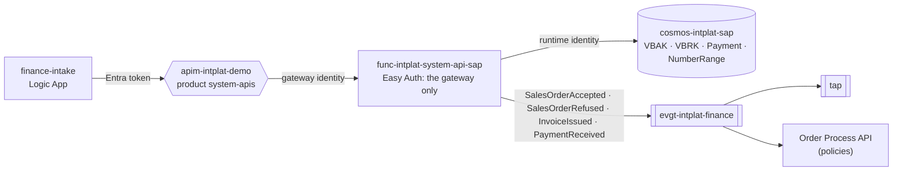

# system-api-sap

The **[Finance] SAP System API**: the simulated SAP of the finance domain, in the platform's contract. Owned by
the **finance team**. A Python Function on Flex Consumption.

| File | What |
|---|---|
| [`openapi.yaml`](openapi.yaml) | The REST contract (internal: product `system-apis`) |
| [`asyncapi.yaml`](asyncapi.yaml) | The finance facts it publishes on `evgt-intplat-finance` |
| [`sap.py`](sap.py) | SAP's own model and rules, and the mapping to the contract |
| [`function_app.py`](function_app.py) | The routes |
| [`kit.py`](kit.py) | Platform plumbing, the same in every System API: responses, journey, contract validation, Cosmos DB, facts |
| [`infra/`](infra/) | Function (Flex Consumption), storage, Easy Auth |

## Where it sits

| Operation | | Notes |
|---|---|---|
| Create Sales Order | `POST /sales-orders` | Credit check (above 250,000 refused); accepted orders are billed at once. One per order. |
| Retrieve Sales Order | `GET /sales-orders/{erpOrderNumber}` |  |
| Retrieve Invoice | `GET /invoices/{invoiceNumber}` | With the amount paid so far |
| Record Payment | `POST /payments` | The bank statement: PaymentReceived; paid in full when covered |

Every write is idempotent per order where the contract says so: a retry returns what exists and
publishes nothing, so Event Grid's at-least-once delivery never creates a second sales order,
reservation or shipment.

## The contract and SAP

SAP keeps its own model ([backend-systems/sap](https://github.com/azure-intelligence-domain/backend-systems/tree/main/sap)); this API
translates. A System API translates and keeps the system's own rules; it does not decide for the
order domain.

| Contract | SAP |
|---|---|
| `erpOrderNumber` | VBAK.id (VBELN) |
| `orderId` | BSTKD (customer reference) |
| `customerId` | KUNNR / KUNRG |
| `items[]` | VBAP: POSNR, MATNR, KWMENG, NETPR |
| `netValue` | NETWR + WAERK |
| `invoiceNumber` | VBRK.id |

## Tests

`uv run --no-project --python 3.12 --with-requirements requirements.txt --with pytest pytest -q`:
the logic against an in-memory database, every operation is a function, and every published
event matches `asyncapi.yaml` and the envelope.

## Pipeline

`.github/workflows/deploy.yml`: contract check and tests, then on `main`: Bicep, code, and two
smoke tests (the Function refuses calls that skip the gateway; the gateway refuses callers without
a platform token). Ends with a deployment event.
